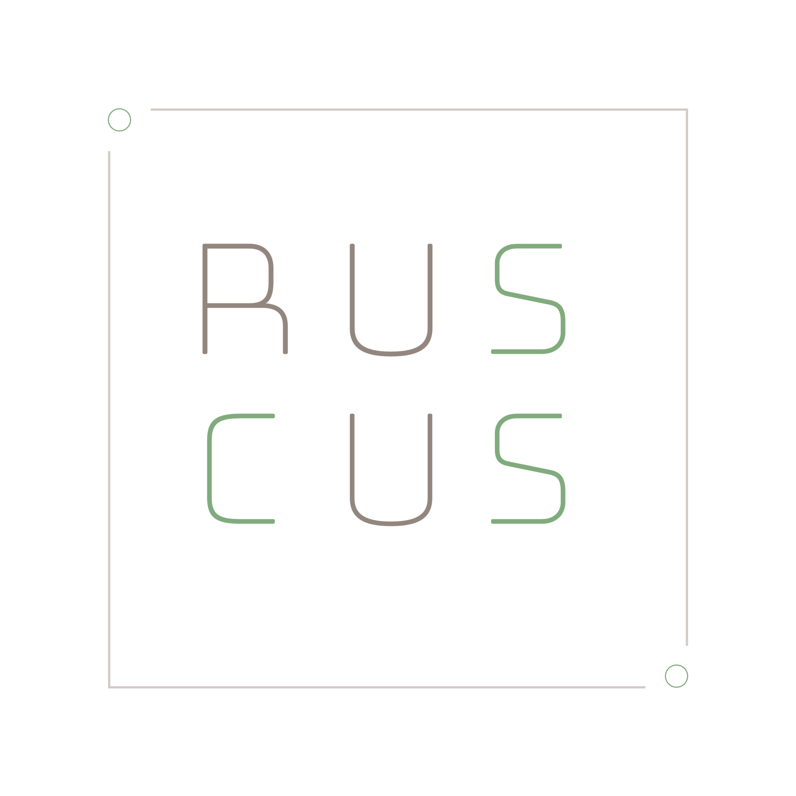

<p align="center">
  
</p>

<br>

<p align="center">
  Ruscus is a TypeScript library that provides a rich vocabulary for defining component styles, with child elements, variants, and nested and global styles as first-class concerns.  It enables the reuse of styles through traits and shared media queries, and can be used with any view layer that allows you to apply class names to DOM elements.
</p>

---

[](https://github.com/justinlocsei/ruscus/actions/workflows/verify.yml)
[](https://www.npmjs.com/package/ruscus)
[](https://github.com/justinlocsei/ruscus/blob/main/LICENSE)


<!-- <toc> -->
- [Installation](#installation)
- [Getting Started](#getting-started)
- [Components](#components)
- [Elements](#elements)
- [Variants](#variants)
- [Nested Styles](#nested-styles)
- [Global Styles](#global-styles)
- [Identifiers](#identifiers)
- [Traits](#traits)
- [Queries](#queries)
- [CSS](#css)
- [Integration](#integration)
  - [Vite](#vite)
- [Why the Name?](#why-the-name)
<!-- </toc> -->

## Installation

```sh
npm install ruscus
```

## Getting Started

Define component styles in a `Card.styles.ts` file:

```ts
import { component } from 'ruscus';

export default component('card')
  .css({
    display: 'block',
    padding: '1rem'
  })
  .elements(e => ({
    title: e({
      fontWeight: 'bold'
    })
  }))
  .variants(s => ({
    compact: s({
      padding: '0.5rem'
    }),

    featured: s({
      border: '2px solid currentColor'
    })
  }))
  .apply();
```

Apply the styles to your component in a `Card.tsx` file:

```tsx
import C from './Card.styles.ts';

export function Card({ compact }: { compact: boolean }) {
  return (
    <article className={card.root(compact && 'compact')}>
      <h1 className={C.title}>
        A card
      </h1>
    </article>
  );
}
```

The styles imported from `card.ts` are a map of element labels to class names that are present in the CSS generated through [bundler integration](#integration), allowing them to be used with any view layer.

## Components

All component styles begin with a call to the `component` function, which requires a unique ID.  Ruscus uses a fluent API for defining component styles, allowing you to chain calls to definition methods before exposing the component's styles as class names via the `.apply` method.

```ts
import { component } from 'ruscus';

export default component('button')
  .css({
    border: 0,
    cursor: 'pointer'
  })
  .apply();
```

Component styles should be the default export of a `.ts` file.  Style discovery happens via bundler integration that looks at the module graph, so there is no need for a particular file suffix.  If you wish to use a convention like `.styles.ts`, however, you're more than welcome to.

## Elements

Components define child elements via the `.elements` method.  Elements can themselves have child elements, allowing for deeply nested trees.

```ts
import { component } from 'ruscus';

export default component('card')
  .elements(e => ({
    body: e({
      padding: '1rem'
    }),

    footer: e({
      borderTop: '1px solid currentColor'
    }),

    header: e().children(() => ({
      icon: e({
        marginRight: '0.5rem'
      }),

      title: e({
        fontWeight: '700'
      })
    }))
  }))
  .apply();
```

A component's elements are known at compile time, allowing for safe access to each element's class name in the view layer:

```ts
import C from './card.ts';

// Valid
C.body
C.footer
C.header.root
C.header.icon

// Type error
C.missing
C.header.missing
```

## Variants

Variants can be defined on the component root or on any element:

```ts
import { component } from 'ruscus';

export default component('card')
  .elements(e => ({
    body: e().variants(s => ({
      active: s({
        background: 'yellow'
      }),

      compact: s({
        padding: '0.5rem'
      })
    }))
  }))
  .variants(s => ({
    featured: s({
      boxShadow: '0 0 0 2px currentColor'
    })
  }))
  .apply();
```

Variants are applied in the view layer via functions on the element or component with variants.  These functions take variant names and falsy or truthy values which can be used to conditionally apply the named variant:

```tsx
import C from './card.ts';

export function Card({
  active,
  compact,
  featured
}: {
  active?: boolean;
  compact?: boolean;
  featured?: boolean;
}) {
  return (
    <article className={C.root(featured && 'featured')}>
      <div className={C.body(active && 'active', compact && 'compact')}>
        A card
      </div>
    </article>
  );
}
```

## Nested Styles

Use the `.nested` method for selectors that are relative to a component or element. A selector can use `&` to refer to the current node, or omit it to generate a selector whose parent is the class name of the component or element:

```ts
import { component } from 'ruscus';

export default component('button')
  .css({
    color: 'black'
  })
  .elements(e => ({
    button: e({
      color: 'red'
    }).nested(s => ({
      '&:active': s({
        color: 'green'
      })
    }))
  }))
  .nested((s, { els }) => ({
    a: s({
      color: 'blue'
    }),

    [`&:hover ${els.button}`]: s({
      textDecoration: 'underline'
    })
  }))
  .apply();
```

The provider function can reference the component's variants, allowing styles to be applied to combinations of variants:

```ts
import { component } from 'ruscus';

export default component('card')
  .variants(s => ({
    compact: s(),
    featured: s()
  }))
  .nested((s, { variants }) => ({
    [variants('compact', 'featured')]: s({
      border: '2px solid currentColor'
    })
  }))
  .apply();
```

## Global Styles

Use the `.global` method for selectors that are not scoped to the component root. This is useful for document-level rules and other intentionally shared CSS:

```ts
import { component } from 'ruscus';

export default component('editor')
  .global(s => ({
    ':root': s({
      colorScheme: 'light dark'
    }),

    html: s({
      fontFamily: 'system-ui, sans-serif'
    })
  }))
  .apply();
```

Global definitions can also contain nested rules such as [media queries](#queries).

## Identifiers

Identifiers are component-specific values that are defined via the `.identifiers` method. String identifiers become class-scoped names, while variable identifiers become scoped CSS custom properties:

```ts
import { component } from 'ruscus';

export default component('card')
  .identifiers({
    animation: 'string',
    spacing: 'variable'
  })
  .elements((e, { ids }) => ({
    body: e({
      animation: `${ids.animation} 500ms`
    }),

    items: e({
      display: 'flex',
      gap: `var(${ids.spacing})`
    })
  }))
  .global((s, { ids }) => ({
    [`@keyframes ${ids.animation}`]: s.rules({
      from: s({ opacity: 0 }),
      to: s({ opacity: 1 })
    })
  }))
  .apply();
```

To reference an identifier in the view layer, use the `identifiers` function:

```tsx
import C from './card.ts';
import { identifiers } from 'ruscus';

const ids = identifiers(C);

export function Card() {
  return (
    <article className={C.root} style={{ [ids.spacing]: '0.75rem' }}>
      <div className={C.items}>
        <div className={C.body}>A card</div>
      </div>
    </article>
  );
}
```

## Traits

Traits provide a way to share styles across components and elements. They are defined once using the `trait` function, and can be applied to components and elements with the `.is` method:

```ts
import { component, trait } from 'ruscus';

const interactive = trait(s =>
  s({
    cursor: 'pointer'
  }).nested({
    '&:hover': s({
      opacity: '0.8'
    })
  })
);

export default component('link')
  .is(interactive)
  .apply();
```

## Queries

The `queries` function maps internal labels to CSS at-rule queries:

```ts
import { queries } from 'ruscus';

export const responsive = queries({
  narrow: '@container card (min-width: 400px)',
  wide: '@media (min-width: 768px)',
});
```

To use queries to style a component, apply them in a `.global` block:

```ts
import { component } from 'ruscus';
import { responsive } from './helpers.ts';

export default component('card')
  .elements(e => ({
    body: e(),
    title: e()
  }))
  .global((s, { els }) => responsive({
    narrow: {
      [els.title]: s({
        fontSize: '0.8em'
      })
    },

    wide: {
      [els.body]: s({
        padding: '2rem'
      })
    }
  }))
  .apply();
```

Each key from the initial `queries` call can be provided to the applicator function.  Queries may be omitted, and any unknown queries will result in a type error.

## CSS

Ruscus takes a permissive approach to CSS, accepting any string as a property and any number or string as a value.  However, to make the authoring experience more enjoyable, it uses [webref](https://github.com/w3c/webref) to generate types for known CSS properties and their keyword values, allowing you to see suggestions like `'flex'` when typing `display: ` in your editor.

If you're writing code that needs to define or handle fragments of CSS, you can use the `CSS` type and `css` function that are part of the Ruscus API:

```ts
import { component, css, type CSS } from 'ruscus';

const padded = css({
  padding: '0.5rem'
});

function withBorder(styles: CSS): CSS {
  return css({
    ...styles,
    border: '1px solid currentColor'
  });
}

export default component('badge')
  .css(withBorder(padded))
  .elements(e => ({ label: e(padded) }))
  .apply();
```

## Integration

Ruscus provides a framework for defining component styles and structure without taking a stance on how those styles are applied to your app.  Integrations connect the generated CSS to a build tool or framework.

### Vite

Install Vite alongside Ruscus:

```sh
npm install vite
```

Add the Ruscus plugin to serve CSS during development and include it in production builds to your Vite config:

```ts
import { defineConfig } from 'vite';
import ruscus from 'ruscus/vite';

export default defineConfig({
  plugins: [ruscus()]
});
```

All style files that define a default export of an applied component and are included in the module graph for your entry point will be used to generate component CSS.

## Why the Name?

In [floristry](https://www.instagram.com/justinlocsei/), ruscus is a common foliage that provides structure without calling too much attention to itself.
